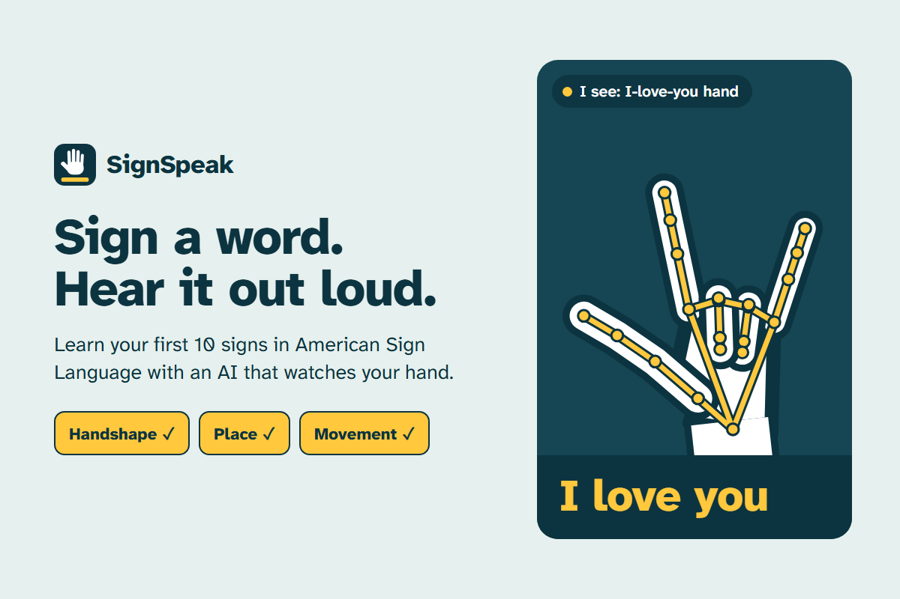

# SignSpeak

**Sign a word. Hear it out loud.**

SignSpeak is a web app that helps hearing people learn their first signs in American Sign
Language (ASL). Your camera works like a mirror: an AI finds your hand and your face, and when
you sign one of 10 ASL signs, the word appears as a live caption and is spoken out loud.
Practice mode teaches each sign and lights up the part you got right: the **handshape**, the
**place** and the **movement**.

Everything runs in the browser. The video never leaves your device, and there is no account
and no paid API.



Built for the [ML Empowerment Build Challenge 3.0](https://ml-build-challenge-3.devpost.com/) (2026).

## What it does

- **Talk mode.** Sign, and SignSpeak writes the words as captions under the mirror and says
  each one out loud. Signs build a sentence (for example "Hello thank you"). **Speak** reads the
  whole sentence, **Undo** removes the last word, **Clear** starts over.
- **Practice mode.** One sign at a time, shown as three tiles: handshape, place and movement.
  Each tile turns yellow the moment you get that part right, and a hint tells you what to fix
  ("Spread your fingers apart", "Touch your chin with your thumb"). A yellow ring on the video
  shows where your hand should go. Sign it 3 times and it's learned (saved on your device).
- **I see.** A label on the video always says what the AI sees right now, for example
  "I see: open hand at your chin", so a wrong guess is easy to understand.

### The 10 signs

| Sign | Handshape | Place | Movement |
|---|---|---|---|
| Hello | Flat hand, fingers together | Fingertips at the side of the forehead | Out, like a salute |
| Thank you | Flat hand | Fingertips on the chin | Forward and down |
| Yes | Fist | In front of you | Wrist nods up and down |
| No | Index and middle finger with the thumb | In front of you | Fingers snap shut on the thumb |
| Please | Flat hand | On the chest | Rub in a circle |
| Sorry | Fist, thumb along the side | On the chest | Rub in a circle |
| I love you | Thumb, index and pinky out | In front of you | Hold still |
| Mother | Open hand, fingers spread | Thumb on the chin | Tap |
| Father | Open hand, fingers spread | Thumb on the forehead | Tap |
| Eat | Fingertips together on the thumb (flat O) | At the mouth | Tap |

Some pairs are there on purpose, because they teach how sign languages work: **Mother** and
**Father** have the same handshape in a different place, and **Please** and **Sorry** have the
same place and movement with a different handshape.

## How to run it

It's plain HTML, CSS and JavaScript with no build step. The camera only works from
`http://localhost` or an `https://` address, so start a small local server in this folder:

```bash
python -m http.server 8000
```

Then open <http://localhost:8000> in Chrome or Edge and press **Turn on camera**.

The first start needs internet: the browser downloads the MediaPipe library and the two AI
models (about 20 MB, then cached).

**Live on GitHub Pages:** in the repository, open Settings → Pages → Deploy from a branch →
`main` / root. The app then runs at `https://<user>.github.io/signspeak/`, on phones too.

**Tips for good results:** good light, one hand up, and your face in the picture (many signs
are measured from your face).

**Debug view:** open the app with `?debug` at the end of the address
(`http://localhost:8000/?debug`) to see the numbers behind every decision: how much each
finger bends, the finger spread and the scores of the top handshapes.

## How it works

```
camera frame
  → MediaPipe Hand Landmarker: 21 points on the hand, in 2D and 3D
  → MediaPipe Face Detector: 6 points on the face (eyes, nose, mouth, ears)
  → features: how much each finger bends, fingertip reach, finger spread, thumb position
  → handshape: fuzzy rules give each handshape a score from 0 to 1 and a hint
  → place: where the hand is compared with the forehead, chin, mouth or chest,
           measured in face widths so it works near and far from the camera
  → movement: the last 3 seconds of positions (a nod, a circle, a snap, moving away…)
  → a sign is complete → caption + voice
```

1. **Seeing the hand.** Google's MediaPipe models are neural networks that run inside the
   browser (WebAssembly and the graphics chip). The hand model gives 21 points, including 3D
   "world" points in meters. SignSpeak uses the 3D points for the handshape, so the rules still
   work when the hand turns.
2. **Handshape** (`js/features.js`, `js/handshapes.js`). Each finger gets a *bend* (the sum of
   the angles at its three joints), a *reach* (fingertip to wrist) and the distance to the thumb
   tip. Each handshape is a list of checks like "index finger straight" or "fingers together".
   Every check returns a soft score from 0 to 1, and the handshape's score is its weakest check.
   That weakest check is also the hint the app shows.
3. **Place** (`js/location.js`). From the eyes and mouth, SignSpeak estimates the forehead, chin
   and chest, and follows the tilt of the head.
4. **Movement** (`js/recognizer.js`). The recognizer keeps the last 3 seconds of frames. Each
   movement is a small detector: *nod* counts up and down swings of the knuckles, *circle* adds
   up how far the hand turns around its center, *snap* looks for "open" followed by "closed"
   within 0.8 seconds, *away* and *down* measure how far the hand moved from where it rested.
5. **No double words.** After a sign, the same sign waits until you drop your hand, and the next
   0.9 seconds are ignored, so lowering your hand doesn't start a new sign.

### Testing

- **34 automated tests** (`npm test`, or `node tests/run.js`): a small 3D hand model
  (`js/handmodel.js`) builds hands in every handshape, turned at random angles with noise, and
  "plays" each sign in front of a pretend face. The tests check that each sign is recognized
  once, that similar movements are not (waving, resting, pointing, dropping the hand after a
  sign), and that Practice gives the right hints.
- **Real hands** (`tests/real-hands.html`, open it through the local server): MediaPipe runs on
  photos of ASL alphabet letters from the public
  [Marxulia/asl_sign_languages_alphabets_v03](https://huggingface.co/datasets/Marxulia/asl_sign_languages_alphabets_v03)
  dataset. Several letters use SignSpeak's handshapes, and others must not be mistaken for them.
  Latest run (40 photos per letter; only photos where MediaPipe found a hand count):

  | Letters | Should be | Result |
  |---|---|---|
  | A, S, E | Fist | 75 of 79 |
  | B | Flat hand | 22 of 28 |
  | U, V | Two fingers | 39 of 39 |
  | Y, L, W, I | None of SignSpeak's handshapes | 109 of 110 |
  | C | None | 20 of 25 (5 read as a flat hand) |
  | O | Flat O (the letter O is rounder) | 12 of 24 |

  The thresholds were tuned while looking at these photos, so this is a sanity check that the
  rules fit real hands, not an independent accuracy score.
- **The whole app, end to end:** a photo of a real fist, moved up and down on a fake camera,
  went through MediaPipe, the recognizer and the screen, and the app wrote and said "Yes".
  Place and movement for the other signs are covered by the automated tests; trying them with
  your own camera is the real test.
- **Drawings** (`tests/gallery.html`) shows every handshape, place and movement picture.

## Files

| File | What it does |
|---|---|
| `index.html` | The page: mirror, Talk panel, Practice panel, About |
| `css/style.css` | All the design (see `DESIGN.md`) |
| `js/app.js` | Connects the camera, the AI and the screen |
| `js/vision.js` | Loads MediaPipe and runs the hand and face models on each frame |
| `js/features.js` | Turns 21 hand points into finger bend, reach, spread and thumb numbers |
| `js/handshapes.js` | The 6 handshapes as lists of checks with hints |
| `js/location.js` | Forehead, chin, mouth and chest from the face points |
| `js/recognizer.js` | Remembers the last 3 seconds and detects each movement |
| `js/signs.js` | The 10 signs: handshape, place, movement and how-to text |
| `js/illustrate.js` | Draws the teaching pictures as SVG from the hand model |
| `js/handmodel.js` | A small 3D hand model (for the pictures and the tests) |
| `js/draw.js` | Draws the yellow hand skeleton and the target ring on the video |
| `js/speech.js` | Says words out loud with the browser's voice |
| `js/progress.js` | Remembers practice progress on this device |
| `tests/` | Automated tests, the real-photo check and the drawings page |
| `design/` | The icon and thumbnail source pages |

## Tech

- [MediaPipe Tasks Vision](https://ai.google.dev/edge/mediapipe/solutions/guide) 1.0.1: Hand
  Landmarker and Face Detector (BlazeFace short range), loaded from jsDelivr and Google's model
  storage.
- Web Speech API for the voice, `localStorage` for practice progress.
- [Atkinson Hyperlegible Next](https://fonts.google.com/specimen/Atkinson+Hyperlegible+Next),
  a typeface made by the Braille Institute for readers with low vision.
- No framework and no build step, so every line is easy to read and change.

## Limits

SignSpeak knows 10 one-handed signs. ASL is a full language with its own grammar, facial
expressions and many two-handed signs, and it is different from other sign languages (for
example Israeli Sign Language). SignSpeak is a first step for hearing learners, not a
translator. To learn ASL, learn from Deaf teachers, for example at
[Lifeprint (ASL University)](https://www.lifeprint.com/).

The rules are hand-written, not learned from signing videos, so people with different hands,
cameras and signing styles may need to sign slowly and clearly. The `?debug` view shows why a
sign wasn't recognized.

## Credits

- Hand and face tracking: [MediaPipe](https://github.com/google-ai-edge/mediapipe) by Google (Apache 2.0).
- Test photos: [Marxulia/asl_sign_languages_alphabets_v03](https://huggingface.co/datasets/Marxulia/asl_sign_languages_alphabets_v03) on Hugging Face (used only for testing; not included in this repository).
- Typeface: Atkinson Hyperlegible Next by the Braille Institute (SIL Open Font License).
- Built with help from **Claude**, an AI assistant by Anthropic.

## License

MIT. See [LICENSE](LICENSE).
